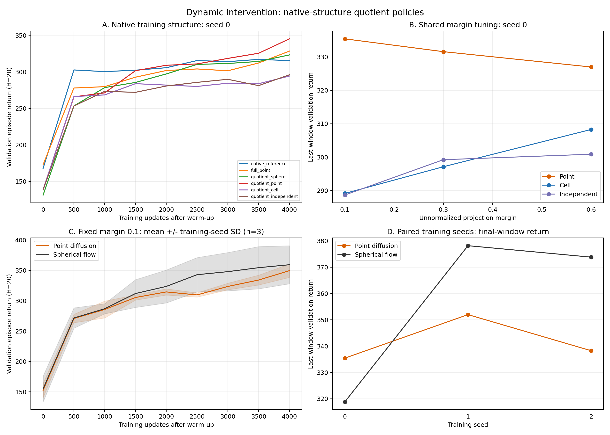

# Native-structure diffusion study: completed results, 2026-11-04

**All 18 new runs are complete and audited: 6 native-structure arms plus 12 margin/replication arms.** Together with the separate historical 14-arm study, all 32 authorized runs across four campaigns are complete. No new RL experiment is queued by this report.

The main scientific result is negative for the current cell-coupling proposal. A shared margin of **0.6** improves the cell arm at seed 0, but it remains below point diffusion. Point diffusion's seed-0 advantage over quotient spherical flow reverses on both new seeds: the paired last-window difference over seeds 0/1/2 is **-15.056 ± 27.832** (mean ± sample training-seed SD, n=3). This does not support a diffusion superiority or stability claim.

[Vector figure](learning_and_replication.pdf) · [Machine-readable study](study.json) · [Rebuild script](../../analysis/build_native_study_report.py)

## Protocol and completion

All runs use the same released Dynamic Intervention instance: N40/A20/B10/H20, instance seed 0; 1,000 warmup interactions plus 4,000 training interactions and updates. Batch size is 64, actor hidden width 256, learning rate 0.0004, 12 behavior candidates, 16 smoothed Bellman candidates, and 12 sampler steps. Native critic updates, Q normalization, alpha schedule, clipping, execution perturbation, and trimmed Bellman target are retained. Diffusion bridge sigma remains 0.5. The released full budget is 40,000 updates; these are short controlled experiments, not full-budget reproduction claims.

Each run has exit 0, the exact config/source/instance identities, 5,000 environment steps, 4,000 critic updates, 4,000 actor updates, 250 complete H20 training episodes, nine scheduled validation evaluations, 50 final heldout episodes, and finite saved scientific state. Local deep audits pass for all 18 mirrored checkpoints. Total new work: 90,000 environment interactions and 72,000 training updates. The current local suite records 54 passing tests; exact storage rechecks provide additional full-run evidence.

Validation uses the same 20 episode seeds 100000–100019 at steps 0,500,…,4000, with evaluation RNG isolated from training. **Last-window** is the mean of steps 3500 and 4000; **AUC** is trapezoidal area over the full nine-point validation curve divided by 4000. Evaluation selects the critic's best of 12 candidates without the training behavior's final execution perturbation. Reported returns therefore refer to that evaluation procedure. No checkpoint or hyperparameter is selected using heldout results.

## Stage A: native-structure bridge, seed 0

| Arm | Last-window validation | Validation AUC | Final validation | Wall seconds |
|---|---:|---:|---:|---:|
| `native_reference` | 316.331 | 299.974 | 315.508 | 477.4 |
| `full_point` | 320.364 | 290.138 | 328.482 | 308.2 |
| `quotient_sphere` | 318.809 | 284.790 | 323.270 | 424.1 |
| `quotient_point` | 335.431 | 293.123 | 345.295 | 264.4 |
| `quotient_cell` | 289.115 | 270.713 | 294.355 | 263.3 |
| `quotient_independent` | 288.648 | 269.201 | 296.053 | 262.3 |

Point diffusion in the quotient space has the highest last-window score in this discovery screen. The native full-space reference has the highest AUC (299.974), so the point result does not dominate the full learning curve. Coupled cell (289.115) and independent cell (288.648) are nearly tied at margin 0.1 and both trail point (335.431). The native full-space reference remains seed-0-only; quotient replication does not turn it into a replicated baseline.

## Stage B: all 12 completed arms

| Arm | Seed | Margin | Last-window validation | Validation AUC | Final validation | Wall seconds |
|---|---:|---:|---:|---:|---:|---:|
| `point_m010_recheck` | 0 | 0.1 | 335.431 | 293.123 | 345.295 | 255.9 |
| `sphere_m010_recheck` | 0 | 0.1 | 318.809 | 284.790 | 323.270 | 413.2 |
| `point_m010_seed1` | 1 | 0.1 | 351.975 | 305.618 | 362.197 | 260.4 |
| `sphere_m010_seed1` | 1 | 0.1 | 378.186 | 329.645 | 379.757 | 415.9 |
| `point_m010_seed2` | 2 | 0.1 | 338.245 | 299.390 | 341.315 | 260.5 |
| `sphere_m010_seed2` | 2 | 0.1 | 373.825 | 321.825 | 375.120 | 423.0 |
| `point_m030` | 0 | 0.3 | 331.590 | 290.121 | 338.167 | 261.0 |
| `cell_m030` | 0 | 0.3 | 297.114 | 275.305 | 301.653 | 261.7 |
| `independent_m030` | 0 | 0.3 | 299.224 | 276.467 | 305.840 | 260.8 |
| `point_m060` | 0 | 0.6 | 326.995 | 291.055 | 328.040 | 263.4 |
| `cell_m060` | 0 | 0.6 | 308.283 | 283.183 | 310.663 | 264.9 |
| `independent_m060` | 0 | 0.6 | 300.864 | 276.800 | 304.330 | 265.0 |

### Shared margin selection

The prespecified rule averages last-window validation equally across point, coupled cell and independent cell, then breaks an exact tie with their mean AUC and finally the smaller margin. The historical margin-0.1 group is admitted only after exact storage equivalence passes and is counted once. The new point recheck is not an additional independent observation. Heldout values and favorable cell-minus-control gaps do not select the margin.

| Margin | Point | Cell | Independent | Three-method mean | Mean AUC | Cell − point | Cell − independent |
|---:|---:|---:|---:|---:|---:|---:|---:|
| 0.1 | 335.431 | 289.115 | 288.648 | 304.398 | 277.679 | -46.316 | +0.468 |
| 0.3 | 331.590 | 297.114 | 299.224 | 309.309 | 280.631 | -34.476 | -2.110 |
| 0.6 | 326.995 | 308.283 | 300.864 | 312.047 | 283.679 | -18.712 | +7.419 |

**Shared margin 0.6 is selected.** Cell improves from 289.115 to 308.283, but point remains higher at 326.995. The cell-minus-independent difference changes sign across margins, and all factorial arms use only seed 0. The result supports a limited margin intervention, not a stable coupling advantage. The earlier fixed-checkpoint execution-flip probe (0.897/0.788/0.603 at margins 0.1/0.3/0.6) motivated the intervention; it is not a retrained-policy or training-curve robustness measurement. These results do not isolate noise robustness from all other consequences of changing endpoint laws.

### Fixed point-versus-sphere replication

This comparison keeps margin 0.1 and bridge sigma 0.5, specified from Stage A before the margin-factorial results. All six runs use the same Stage B source. Seed 0 is the known discovery seed repeated to check storage equivalence; only seeds 1 and 2 are new training-seed evidence. The selected margin 0.6 is not substituted into this fixed comparison.

| Seed | Scope | Point last-window | Sphere last-window | Point − sphere | Point AUC − sphere AUC |
|---:|---|---:|---:|---:|---:|
| 0 | known discovery seed repeated | 335.431 | 318.809 | +16.622 | +8.333 |
| 1 | new training seed | 351.975 | 378.186 | -26.211 | -24.027 |
| 2 | new training seed | 338.245 | 373.825 | -35.580 | -22.435 |

| Across training seeds 0/1/2 (n=3) | Last-window mean ± sample SD | AUC mean ± sample SD |
|---|---:|---:|
| point | 341.884 ± 8.852 | 299.377 ± 6.248 |
| sphere | 356.940 ± 33.095 | 312.087 ± 23.961 |
| point minus sphere | -15.056 ± 27.832 | -12.710 ± 18.241 |

For new seeds 1/2 alone, paired last-window difference is -30.896 ± 6.625; paired AUC difference is -23.231 ± 1.126 (n=2). Both new seeds favor spherical flow. Three pairs, including a discovery seed, support a limited repeatability assessment, not a precise population estimate or a significance claim. These SDs measure training-seed variation on one fixed environment instance; rollout episode SD is reported separately below.

## Compute and implementation scope

All arms have equal environment/update budgets and 9,600 recorded native decoder calls. That counter counts executed actions, including evaluation; it does not count neural candidate evaluations. The inherited Heun spherical sampler uses **24 network evaluations per sample**, while diffusion uses **12**. Equal sampler-step settings therefore do not match neural evaluation cost. Timing also includes evaluation, checkpointing, projection, and concurrency. The recorded wall times do not establish an intrinsic speed advantage of diffusion.

| Actor family | Actor parameters | Critic parameters | NFE per sample |
|---|---:|---:|---:|
| Native full-space spherical reference | 107112 | 173570 | 24 |
| Full-space point diffusion | 117392 | 173570 | 12 |
| Quotient spherical flow | 90696 | 173570 | 24 |
| Quotient point/cell/independent diffusion | 92752 | 173570 | 12 |

Tensor-only native sampling passed strict equivalence tests; its paired local microbenchmark was about 1.008×, which is not a meaningful established acceleration. Compact replay reduces a 5,000/100,000-row replay payload from 57,275,424 to 2,842,248 bytes (95.04%). That is replay serialization, not a 95% reduction in complete model checkpoints or runtime memory. The actual point complete checkpoint changes from 61,457,791 to 7,177,477 bytes; sphere changes from 61,424,181 to 7,140,795 bytes.

Both complete seed-0 rechecks exactly reproduce their old resolved configs, every validation/heldout/training-episode return, final learner and optimizer states, environment counters, all RNGs, and valid replay rows/ring positions. Only representation, source identity and timing/artifact fields are excluded. These checks justify pooling the historical margin-0.1 anchors across the storage-only source boundary.

[Point equivalence audit](point_storage_equivalence.json) · [Sphere equivalence audit](sphere_storage_equivalence.json) · [Replay benchmark](../../analysis/replay_storage_benchmark_20261104.json) · [Tensor-path benchmark](../../analysis/fast_native_benchmark_20261104.json)

## Final heldout results: descriptive only

These are final-checkpoint means and within-run episode SDs over 50 seeds 200000–200049. They did not select shared margin, method, checkpoint, or replication parameters. Episode SD is not the uncertainty of an across-training-seed improvement.

| Stage | Arm | Mean return | Episode SD |
|---|---|---:|---:|
| A | `native_reference` | 315.070 | 23.396 |
| A | `full_point` | 318.549 | 22.078 |
| A | `quotient_sphere` | 314.549 | 24.245 |
| A | `quotient_point` | 340.348 | 27.506 |
| A | `quotient_cell` | 293.892 | 24.304 |
| A | `quotient_independent` | 288.549 | 23.908 |
| B | `point_m010_recheck` | 340.348 | 27.506 |
| B | `sphere_m010_recheck` | 314.549 | 24.245 |
| B | `point_m010_seed1` | 361.760 | 22.837 |
| B | `sphere_m010_seed1` | 375.575 | 22.000 |
| B | `point_m010_seed2` | 336.922 | 24.544 |
| B | `sphere_m010_seed2` | 373.412 | 22.845 |
| B | `point_m030` | 342.108 | 27.068 |
| B | `cell_m030` | 297.237 | 24.754 |
| B | `independent_m030` | 301.821 | 21.981 |
| B | `point_m060` | 328.039 | 25.111 |
| B | `cell_m060` | 305.884 | 21.190 |
| B | `independent_m060` | 304.677 | 20.866 |

## Provenance and current completion snapshot

- `native_revision_20261104`: 6 complete; commit `5e2e764907cc727c0060e34f20a69362aab44a5f`; scientific source `030e1c799e990310b3c2d44a1872b051baefdc141267d42bf048df5c5d1eb53b`. [Summary](../native_revision_20261104/summary.json), [local deep audit](../native_revision_20261104/local_checkpoint_audit.json), [deployment manifest](../native_revision_20261104/deployment.json).
- `native_margin_20261104`: 12 complete; commit `00a7eedece8156c8f7e88f6a887e0268837b94eb`; scientific source `6eb3126bc49621d34308013091304b3fb46bb17e9c35bec7062d322cf656a66c`. [Summary](../native_margin_20261104/summary.json), [local deep audit](../native_margin_20261104/local_checkpoint_audit.json), [deployment manifest](../native_margin_20261104/deployment.json).

Only `solvercell/learner.py` and `solvercell/trainer.py` differ between the two frozen scientific snapshots, implementing compact Replay serialization/save/restore. Historical sources and manifest configs remain immutable. Run the report rebuild from the repository root with `python analysis/build_native_study_report.py`; it verifies configs, exits, counters, deep-audit outcomes, all validation curves and metrics before writing this report.

The recorded remote snapshot is **2026-11-04T09:36:30.364586+00:00**: all four campaign controllers report complete, `training_workers=[]`; GPU snapshot is `NVIDIA RTX A6000, 684 MiB, 4 %`; `unrelated_original_worker_exists=false`. Our experiments used CPU and did not signal or modify the unrelated GPU worker. The prior worker was no longer present at this snapshot; no claim is made about its continued execution. [Snapshot](final_remote_state.json).

## Historical results and research decision

The initial 8-arm matched-harness screen and 6-arm temperature factorial are a separate completed 14-run historical study under source `258f8ec3afa41bab34e4456f19b114bb09c64d0a56ef22a914b24ad20258c914`. Their critic/decoder adaptation differs from this native-structure study; they are not pooled into the replication or margin statistics. [Historical report](../study_20261104/RESULTS.md).

The present results reject treating shorter source-to-cell Euclidean paths as sufficient evidence of better policy improvement. The methodology audit explains why preserving an action label does not preserve the native noisy execution kernel, and why minimum Euclidean transport is not the minimum-KL lift of an action-space PMD step. Current endpoint-weighted denoising uses stochastic-interpolant regression; it has not tested trajectory-level denoising likelihood credit or established an advantage specific to diffusion over flow matching. Best-of-K behavior, fixed execution noise, and the trimmed bootstrap also limit claims about an exact deployment-policy value function.

A subsequent inexpensive oracle check also gives a negative efficiency result for the simplest conditional-branch gradient estimator. On three fixed real late-replay states × four declared coordinates (12 cases, 20,000 estimates per case), its two-query full-gradient covariance trace is **1.473–1.862 times** that of averaging two independent score-function samples; all 12 cases are worse at equal Q-query cost. The analytic integration and finite-difference checks pass, which validates the calculation, not efficiency. This uses a declared mean-zero, sigma-0.5 primitive20 Gaussian test kernel and exact immediate-reward oracle; it is neither the trained policy's terminal kernel nor learned-Q/long-horizon RL evidence. It blocks promoting this first estimator into a training sweep. The next diagnostic should first establish the actual denoising-step credit problem.

[Conditional-branch diagnostic](../continuation_branch_audit/summary.json) · [Continuation critic derivation and negative gate](../../docs/NOISE_CONTINUATION_CRITIC.md). No additional RL run was launched for this diagnostic.

[Methodology and source audit](../../docs/METHODOLOGY_AUDIT.md) · [Support/prior audit](../../docs/SOLVER_SUPPORT_AND_PRIOR.md) · [Feasible-exchange rethink](../../docs/FEASIBLE_EXCHANGE_RETHINK.md) · [Diffusion redesign decision](../../docs/DIFFUSION_REDESIGN_DECISION.md) · [Prespecified margin/replication design](../../docs/NATIVE_MARGIN_FOLLOWUP.md). Design documents preserve their preparation-time statements; this report records actual completion. New mechanism proposals are research designs only, not implemented or validated RL results. Further experiments require a fresh bounded design; none is launched by this analysis.
