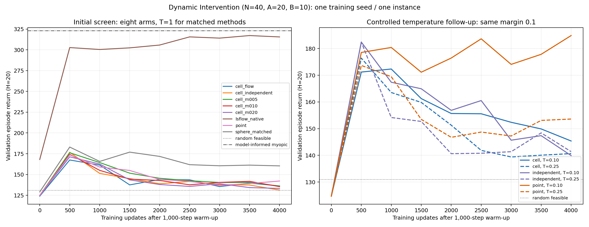

# SolverCell-RL 首轮结果：2026-11-04

本地工作空间与远端实验已完成。**两轮共 14 组全部跑完并通过 checkpoint 深审，当前没有运行或排队的本项目实验。当前实现没有显示出优于 LSFlow 的学习性能。**

## 方法与 benchmark

实现了源条件 solver-cell diffusion：选定目标动作 a 后，将当前起点噪声 z 投影到解码为 a 的 robust decision cell，作为 stochastic-interpolant diffusion 的监督终点。加入了 old-point、独立噪声 cell、无 SDE 采样噪声和 matched spherical flow 对照；nearest-cell 距离性质和终点动作保持通过独立 QP 与实际 learner 测试。

使用官方 LSFlow Dynamic Intervention 的有效配置 N=40、A=20、B=10、H=20，instance seed=0。官方仓库固定 commit `7e50d03e7129974a11061c9ce500bc2dc5593246`。这是 released benchmark 的明确配置，论文没有提供 primitive intervention 数 A，因此不称为论文数值的精确复现。环境参数和整段轨迹与 pinned source 对照通过。

每组 1000 warmup + 4000 training updates，training seed=0；9 次 validation（每次 20 episodes）和最终 50 held-out episodes。主排名是最后 3500、4000 两次 validation 的均值，AUC 使用完整曲线并除以 4000。所有回报均为 H=20 的原始 episode return。

## 全部实验

| Campaign | Arm | Temperature | Margin | 末窗 validation | Validation AUC | Held-out mean |
|---|---|---:|---:|---:|---:|---:|
| initial | lsflow_native | native schedule | — | 316.331 | 299.974 | 315.070 |
| initial | sphere_matched | 1.00 | — | 160.845 | 165.737 | 159.380 |
| initial | point | 1.00 | 0.10 | 140.674 | 147.863 | 143.895 |
| initial | cell_m010 | 1.00 | 0.10 | 138.609 | 145.829 | 143.866 |
| initial | cell_m005 | 1.00 | 0.05 | 138.285 | 148.951 | 142.673 |
| initial | cell_flow | 1.00 | 0.10 | 137.968 | 144.909 | 144.474 |
| initial | cell_independent | 1.00 | 0.10 | 134.314 | 144.628 | 140.139 |
| initial | cell_m020 | 1.00 | 0.20 | 133.779 | 144.164 | 136.606 |
| temperature | point_t010 | 0.10 | 0.10 | 181.346 | 174.603 | 184.777 |
| temperature | point_t025 | 0.25 | 0.10 | 153.340 | 153.943 | 156.910 |
| temperature | cell_t010 | 0.10 | 0.10 | 147.635 | 156.667 | 148.889 |
| temperature | independent_t025 | 0.25 | 0.10 | 144.896 | 149.194 | 141.880 |
| temperature | independent_t010 | 0.10 | 0.10 | 143.648 | 157.185 | 145.530 |
| temperature | cell_t025 | 0.25 | 0.10 | 140.359 | 150.634 | 146.965 |

## 结论与下一步判断

- 原始 margin=.05/.10/.20 筛选没有给出显著的实际改善方向。Cell T=1 的末窗 138.609，point 140.674，matched spherical flow 160.845。
- 最终 checkpoint 上，T=1 的候选 Q 权重 ESS 约 7.56/8。基于这个诊断追加 T=.1/.25 的 3-method × 2-temperature 受控比较，其他配置完全不变。
- 预声明的共同温度选择使用三个方法的末窗 validation 均值：T=.1 为 157.543，T=.25 为 146.198，因此选 T=.1。没有用 held-out 选择。
- T=.1 下，cell=147.635，point=181.346，independent-cell=143.648。Cell 比 point 差 33.711；比 independent-cell 高 3.988，但 T=.25 时该差值变为 -4.537。现有数据不能支持 pairing 收益稳定，也不能支持 cell 优于旧点终点。
- Native LSFlow 的末窗 316.331、AUC299.974，500 steps 后就到约303并维持提升。它与新方法在 decoder、critic、容量、更新频次和权重机制上有差别，不能从这个差距单独定位原因；当前完整系统的性能差距仍然明确。
- Random feasible validation mean=130.980；model-informed myopic heuristic=323.145。后者使用已知环境模型，属于额外行为参照。

下一阶段应先保留 native LSFlow 的 critic、policy improvement 和 decoder，减少一次改变的结构，再评估替换生成目标的价值。W-transpose decoder 有重复列与结构性 ties，不能直接套用当前 primitive-cost 的严格 margin cell。当前筛选没有通过扩大训练预算和多-seed验证的正向门槛；这些数据也不能证明整个理论方向不可行。

## 完成证据与边界

14/14 exit zero，全部 config/source/instance/checkpoint 一致；每组 5000 environment steps、4000 critic updates、250 个完整 H20 episodes。Matched arms 为2000 actor updates；native 为4000 actor updates及8次 myopic pretraining。全量 checkpoint 模型、target、optimizer、replay 浮点数据有限；原始 episode returns 重算均值、末窗、AUC均吻合。

本轮合计 56000 training updates、70000 environment steps。它们仍是一个 training seed、一个 instance、各自只有4000 updates的短程筛选；论文 released full budget为40000 updates。评价 episode 的方差不是 training-seed 稳定性。

原版 adapter 保留原始40维 arm-cost decoder和原始更新，screen 将 Heun sampling steps缩短为12（released为36）；matched methods共用20维 primitive decoder/action critic。Spherical Heun每步两次网络前向，diffusion Euler每步一次；本轮没有等FLOPs保证。

首批与温度批的 actor logger 在非actor更新步记录，缺少actor训练诊断曲线；回报与checkpoint审计不受影响。ESS和transport来自单独标注的只读最终checkpoint诊断，不是完整训练曲线。本地后续源码已修复缓存和恢复日志，并增加2项实际训练/恢复测试；这些修复不属于本轮冻结源码。当前本地34项测试全部通过，冻结实验版本为32项。

## 复现与文件

实验科学源码 SHA256：`258f8ec3afa41bab34e4456f19b114bb09c64d0a56ef22a914b24ad20258c914`。初始source commit `ec41ef1`；温度准备commit `f6b7d1d`具有相同科学源码。

远端完整源码、配置、outputs和controller记录：

- `/home/li/SolverCell-RL/deployments/intervention_screen_20261104/`
- `/home/li/SolverCell-RL/deployments/temperature_screen_20261104/`

远端使用 `/home/li/SolverCell-RL/.venv/bin/python`，Torch2.5.1；本地验证用Torch2.3.0。训练为CPU单线程。初始CPU24/25，温度批CPU24/26，重叠期间最多3个训练线程。无GPU训练，原有openpi worker保持运行。

本地outputs镜像保存全部14个最终checkpoint与原始日志；reports下有每批CSV/JSON/LaTeX、曲线和两次独立深审。复现旧实验应使用记录的commit或远端冻结snapshot与新输出目录；历史manifest会拒绝不同科学源码。
